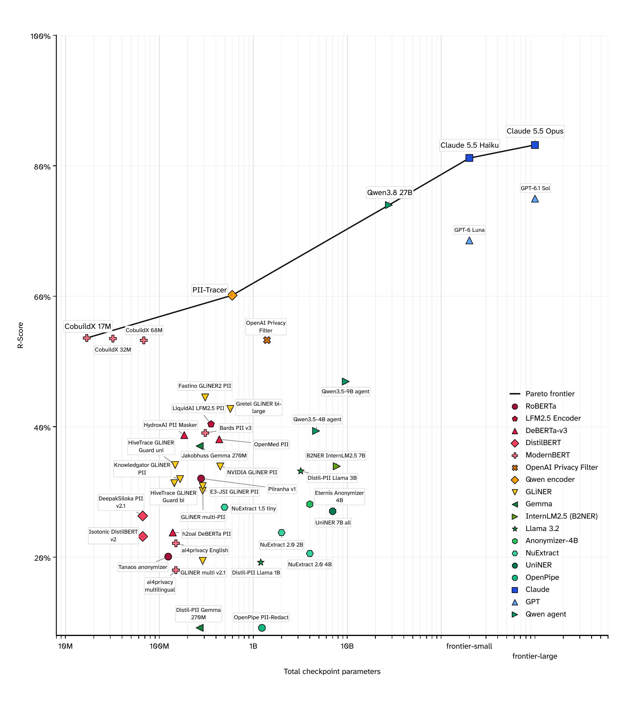

## Evaluations

<figure class="paper-figure">
    

        
    

    <figcaption>Total checkpoint parameter count versus R-Score.</figcaption>
</figure>

### Overall Model Leaderboard

| Rank | Model | Family | R-Score mean |
|---:|---|---|---:|
| 1 | `Claude Opus 5.5` | General-purpose agent | 0.832 |
| 2 | `Claude Haiku 5.5` | General-purpose agent | 0.812 |
| 3 | `GPT-6.1 Sol` | General-purpose agent | 0.750 |
| 4 | `Qwen3.8-27B agent` | General-purpose agent | 0.740 |
| 5 | `GPT-6 Luna` | General-purpose agent | 0.686 |
| 6 | `Perplexity PII-Tracer` | Token-level | 0.601 |
| 7 | `CobuildX 17M` | Token-level | 0.536 |
| 8 | `CobuildX 32M` | Token-level | 0.535 |
| 9 | `OpenAI Privacy Filter` | Token-level | 0.533 |
| 10 | `CobuildX 68M` | Token-level | 0.532 |
| 11 | `Qwen3.5-9B agent` | General-purpose agent | 0.469 |
| 12 | `Fastino GLiNER2 PII` | Span-level | 0.445 |
| 13 | `Gretel GLiNER bi-large` | Span-level | 0.427 |
| 14 | `LiquidAI LFM2.5 PII` | Token-level | 0.404 |
| 15 | `Qwen3.5-4B agent` | General-purpose agent | 0.393 |
| 16 | `Bards PII v3` | Token-level | 0.390 |
| 17 | `HydroxAI PII Masker` | Token-level | 0.387 |
| 18 | `OpenMed SuperClinical PII` | Token-level | 0.381 |
| 19 | `Jakobhuss Gemma 270M` | Specialized generator | 0.370 |
| 20 | `HiveTrace GLiNER Guard uni` | Span-level | 0.341 |
| 21 | `B2NER InternLM2.5 7B` | Specialized generator | 0.339 |
| 22 | `NVIDIA GLiNER PII` | Span-level | 0.339 |
| 23 | `Distil-PII Llama 3B` | Specialized generator | 0.332 |
| 24 | `Piiranha v1` | Token-level | 0.321 |
| 25 | `Knowledgator GLiNER PII` | Span-level | 0.320 |
| 26 | `HiveTrace GLiNER Guard bi` | Span-level | 0.313 |
| 27 | `GLiNER multi-PII` | Span-level | 0.309 |
| 28 | `E3-JSI GLiNER PII` | Span-level | 0.302 |
| 29 | `Eternis Anonymizer 4B` | Specialized generator | 0.281 |
| 30 | `NuExtract 1.5 tiny` | Specialized generator | 0.277 |
| 31 | `UniNER 7B all` | Specialized generator | 0.270 |
| 32 | `DeepakSiloka PII v2.1` | Token-level | 0.263 |
| 33 | `h2oai DeBERTa PII` | Token-level | 0.238 |
| 34 | `Lakshyakh93 DeBERTa PII` | Token-level | 0.238 |
| 35 | `NuExtract 2.0 2B` | Specialized generator | 0.238 |
| 36 | `Isotonic DistilBERT v2` | Token-level | 0.232 |
| 37 | `ai4privacy English` | Token-level | 0.221 |
| 38 | `NuExtract 2.0 4B` | Specialized generator | 0.206 |
| 39 | `Tanaos anonymizer` | Token-level | 0.201 |
| 40 | `GLiNER multi v2.1` | Span-level | 0.194 |
| 41 | `Distil-PII Llama 1B` | Specialized generator | 0.192 |
| 42 | `ai4privacy multilingual` | Token-level | 0.180 |
| 43 | `Distil-PII Gemma 270M` | Specialized generator | 0.092 |
| 44 | `OpenPipe PII-Redact` | Specialized generator | 0.092 |

† `h2oai/deberta_finetuned_pii` and `lakshyakh93/deberta_finetuned_pii` are mirrored uploads of the same checkpoint and produce identical scores.
